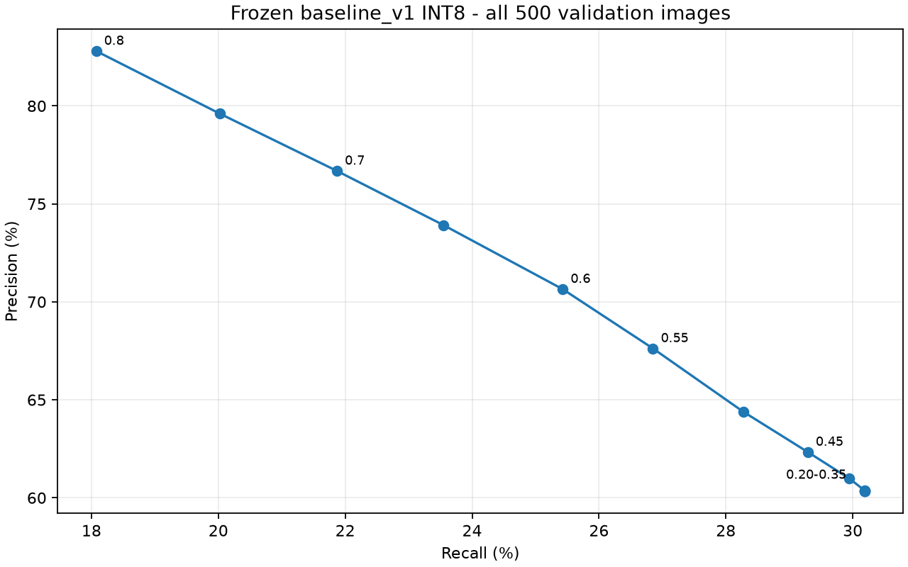
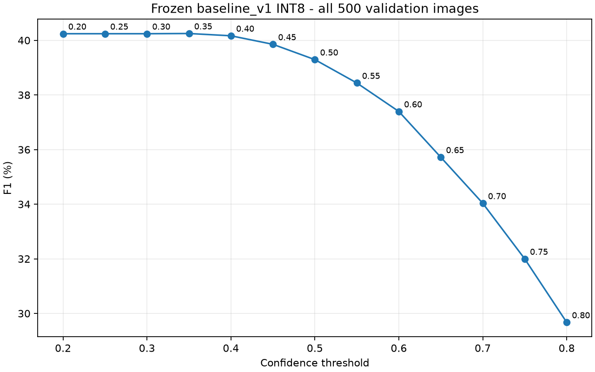
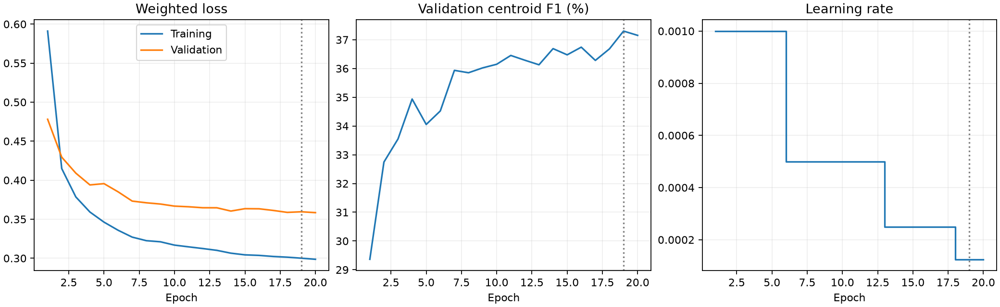
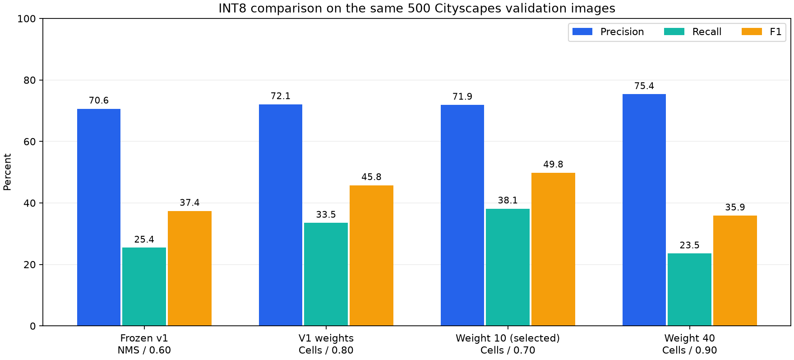

# My baseline_v1 diagnosis and controlled 20 x 20 comparison

I ran this investigation on 2026-10-04, entirely under `tinyml/fomo/` on `tinyml-fomo`.
I retained Fast-SCNN, MicroSeg, BDD100K, the original datasets, the 40 x 40 experiment, and the original baseline artifacts unchanged.
I completed the threshold sweep and visual error analysis before starting the two controlled training runs.

## My frozen reference

I identify the original center-mask 20 x 20 model as `baseline_v1` without moving or copying its model files.
Its checkpoint is `artifacts/diagnosis-center-training-20261004/best.keras`, and its INT8 export is `artifacts/diagnosis-center-export-20261004/model.int8.tflite`.
The INT8 SHA-256 is `359473f21233165ccbc6ea64689a645490d819bb07dd2905ed6dd5fa76f4e372`.
I saved the complete model, dataset, training configuration, per-class metrics, size metrics, and protected artifact hashes in [baseline_v1.json](artifacts/baseline-v1-diagnostics-20261004/baseline_v1.json), with a [short readable summary](artifacts/baseline-v1-diagnostics-20261004/BASELINE_V1.md).
I reproduced all saved INT8 class counts exactly and verified that five fresh model invocations reproduce their saved probability grids bit for bit.

I use all 500 official validation images and all 10,119 labeled Person/Vehicle instances.
The model receives 160 x 160 RGB input and outputs a 20 x 20 background/person/vehicle grid.
The metric is same-class, one-to-one centroid matching within eight input pixels, not bounding-box IoU or semantic-segmentation accuracy.
I count an unmatched prediction in an original void/group region separately as ignored; I do not hide these outputs at inference.
I do not remove tiny objects or cap the number of detections.
These are development-validation results on data already used for checkpoint selection and repeated experimentation, not an independent test of glasses-viewpoint performance.

## Confidence thresholds

A confidence threshold filters the model's winning object scores.
At 0.60, I discard winning object scores below 0.60; this score is not a calibrated guarantee that a detection is correct 60% of the time.
Lowering the threshold can recover objects while allowing more false detections.
I retained the original NMS and matching rules throughout the required sweep.

| Threshold | Precision | Recall | F1 | <2 px recall | 2 to <8 px recall | >=8 px recall |
|---:|---:|---:|---:|---:|---:|---:|
| 0.20 | 60.33% | 30.19% | 40.24% | 17.65% | 26.25% | 54.88% |
| 0.25 | 60.33% | 30.19% | 40.24% | 17.65% | 26.25% | 54.88% |
| 0.30 | 60.33% | 30.19% | 40.24% | 17.65% | 26.25% | 54.88% |
| 0.35 | 60.36% | 30.19% | 40.25% | 17.65% | 26.25% | 54.88% |
| 0.40 | 60.99% | 29.94% | 40.17% | 17.20% | 26.04% | 54.79% |
| 0.45 | 62.33% | 29.29% | 39.85% | 16.34% | 25.49% | 54.15% |
| 0.50 | 64.39% | 28.27% | 39.29% | 14.96% | 24.54% | 53.42% |
| 0.55 | 67.62% | 26.85% | 38.44% | 13.49% | 23.09% | 52.10% |
| 0.60 | 70.65% | 25.43% | 37.40% | 12.37% | 21.53% | 50.64% |
| 0.65 | 73.91% | 23.55% | 35.72% | 10.61% | 19.71% | 48.50% |
| 0.70 | 76.68% | 21.87% | 34.03% | 9.48% | 17.92% | 46.40% |
| 0.75 | 79.61% | 20.02% | 32.00% | 7.95% | 16.15% | 43.98% |
| 0.80 | 82.80% | 18.07% | 29.67% | 6.86% | 14.19% | 41.02% |

| Threshold | Person P / R / F1 | Vehicle P / R / F1 |
|---:|---|---|
| 0.20 | 51.28% / 28.54% / 36.67% | 67.24% / 31.24% / 42.66% |
| 0.25 | 51.28% / 28.54% / 36.67% | 67.24% / 31.24% / 42.66% |
| 0.30 | 51.28% / 28.54% / 36.67% | 67.24% / 31.24% / 42.66% |
| 0.35 | 51.35% / 28.54% / 36.69% | 67.24% / 31.24% / 42.66% |
| 0.40 | 52.10% / 28.06% / 36.47% | 67.62% / 31.14% / 42.65% |
| 0.45 | 53.59% / 27.30% / 36.17% | 68.72% / 30.56% / 42.31% |
| 0.50 | 56.32% / 26.03% / 35.60% | 70.00% / 29.70% / 41.71% |
| 0.55 | 60.46% / 24.58% / 34.95% | 72.36% / 28.30% / 40.68% |
| 0.60 | 63.56% / 22.85% / 33.62% | 75.16% / 27.07% / 39.80% |
| 0.65 | 67.14% / 20.54% / 31.46% | 77.96% / 25.47% / 38.39% |
| 0.70 | 71.07% / 18.59% / 29.47% | 79.80% / 23.96% / 36.85% |
| 0.75 | 74.39% / 16.23% / 26.64% | 82.27% / 22.44% / 35.26% |
| 0.80 | 78.46% / 13.97% / 23.71% | 84.81% / 20.69% / 33.27% |


The highest F1 in this sweep is 40.25% at 0.35, compared with 37.40% at 0.60.
That change recovers 482 additional objects but adds 937 scored false positives across 500 images.
I would not call the highest-recall threshold the best warning setting.
Under the unchanged decoder, 0.55 is a more cautious recall-oriented development option: it adds 144 matches and 232 scored false positives, with 67.62% precision, 26.85% recall, and 38.44% F1.
I retain 0.60 as the frozen baseline and default rather than silently retuning it.
The separate NMS investigation below yields a better balanced candidate than threshold reduction alone.

Scores below roughly one third have no effect here because a winning class in a three-class softmax must have probability at least one third.
Background-winning cells also remain excluded regardless of a lower threshold.
This explains why 0.20, 0.25, and 0.30 give identical results.





I provide all counts, per-class precision/recall/F1, and coarse size recall in [CSV](artifacts/baseline-v1-diagnostics-20261004/threshold_sweep.csv) and [JSON](artifacts/baseline-v1-diagnostics-20261004/threshold_sweep.json).

## What the errors look like

At the frozen operating point, I count 2,573 true positives, 1,069 scored false positives, 7,546 false negatives, and 1,039 ignored predictions.
I generated a [50-example visual review](artifacts/baseline-v1-diagnostics-20261004/review/index.html): 10 true positives, 10 false positives, and 30 false negatives spread across classes and size bands.
Each example includes the source scene, a source-image detail, and the actual cached 160 x 160 input enlarged without inventing detail.
The selection is deterministic and stratified, not a random sample from which to estimate prevalence.
I retained every event in [error_events.json](artifacts/baseline-v1-diagnostics-20261004/error_events.json).

| Missed-object category | Count |
|---|---:|
| Person | 3,038 |
| Vehicle | 4,508 |
| Minimum dimension below 2 px | 2,338 |
| 2 to below 4 px | 2,408 |
| 4 to below 8 px | 1,717 |
| 8 to below 16 px | 750 |
| At least 16 px | 333 |
| Box reaches within 4 input pixels of a frame edge | 411 |
| Another labeled center lies within 8 input pixels | 6,592 |

Class counts and size counts each partition the misses.
Edge and neighbor tags overlap those categories; they are geometric indicators, not proven causes.
The retained box annotations do not provide reliable occlusion labels, so I do not invent an occlusion count.

I visually checked these examples:

- [Tiny missed person](artifacts/baseline-v1-diagnostics-20261004/review/fn/21-person-lt2.jpg): the labeled person becomes about 1.4 pixels wide, with little recognizable detail at the model input.
- [Larger missed person](artifacts/baseline-v1-diagnostics-20261004/review/fn/30-person-8to16.jpg): a person near the frame edge appears among other people and a scooter; crowding and partially obstructed appearance are visible, but I do not assign a dataset-wide occlusion rate.
- [Large missed vehicle](artifacts/baseline-v1-diagnostics-20261004/review/fn/47-vehicle-ge16.jpg): the yellow vehicle is visible and has a prediction on part of it, but no eligible same-class centroid match; a false negative can reflect location or class error rather than complete absence of model response.
- [False Person prediction](artifacts/baseline-v1-diagnostics-20261004/review/fp/10-person-example.jpg): the highlighted detection is on a dark pole area beside the yellow vehicle.

FP means unmatched under the stated centroid protocol.
It can include a duplicate or badly located prediction on a real object, so it is not automatically proof that the scene contains no object there.
These image-level false positives also are not the same as false warnings per minute in a future temporal decision system.

## Size and class effects

I match against all objects together before assigning each object's outcome to a size bin.
This prevents one detection from being credited in multiple bins.
All official overall metrics retain the difficult small instances.

| Min dimension | All count | All recall | Person count | Person recall | Vehicle count | Vehicle recall |
|---|---:|---:|---:|---:|---:|---:|
| lt2 | 2668 | 12.37% | 1601 | 13.80% | 1067 | 10.22% |
| 2to4 | 2940 | 18.10% | 1305 | 23.52% | 1635 | 13.76% |
| 4to8 | 2317 | 25.90% | 758 | 33.38% | 1559 | 22.26% |
| 8to16 | 1393 | 46.16% | 241 | 43.98% | 1152 | 46.61% |
| ge16 | 801 | 58.43% | 33 | 39.39% | 768 | 59.24% |


Objects below eight pixels account for 7,925 of 10,119 labels, or 78.3%, and 6,463 of 7,546 misses, or 85.6%.
This is strong evidence that tiny and small objects dominate the missed-instance count.
It does not prove that low resolution alone causes every miss: recall is still only 50.64% for objects at least eight pixels wide.
Crowding, shared target cells, classification, location error, and decoding also matter.

Person recall is 22.85%, compared with Vehicle recall of 27.07%.
However, 93.0% of people are below eight pixels in minimum dimension, compared with 68.9% of vehicles.
Within each of the three smaller bins, Person recall is higher than Vehicle recall.
I therefore cannot conclude from the aggregate result that Person recognition is intrinsically harder.
Only 33 people are in the at-least-16-pixel bin, so I treat its percentage as particularly uncertain.

## Crowding and NMS

NMS suppresses nearby same-class candidates to avoid duplicate detections.
The baseline suppresses all same-class cells within an eight-input-pixel Chebyshev neighborhood, which can also suppress nearby real people or vehicles.
My frozen-prediction probe partitions the 7,546 misses into these ordered associations:

| First applicable association | Misses |
|---|---:|
| Eligible kept prediction already matched to another object | 3,040 |
| Eligible raw cell removed by NMS | 1,938 |
| Same-class winning cell nearby, but only below threshold | 1,080 |
| No same-class winning cell within the matching radius | 1,488 |

These are mechanism indicators, not independent causal estimates of how many objects a change must recover.
At the annotated center cell, 4,864 misses still have the correct foreground class winning, 1,963 have the wrong foreground class winning, and only 719 have background winning.
That makes a simple explanation of 'the model predicts background everywhere' inconsistent with the saved outputs.
The validation annotations also contain 3,734 extra centers sharing a target cell and 1,821 centers in mixed-class cells.
A perfect hard target grid with the current NMS achieves only 36.14% recall, illustrating target/decoder limitations; it is not a strict upper bound for arbitrary learned outputs.

I therefore documented an additional, separate one-factor ablation using the existing `cells` decoder with neighborhood suppression disabled.
Matching, labels, input, model weights, and ignored-region handling remain fixed.
At 0.60, this increases recall to 52.50% and F1 to 54.42%, but lowers precision to 56.49%.
I then tested higher thresholds and chose 0.80 as the highest-recall tested no-NMS point retaining at least 70% precision on development validation.
This is an explicit comparison choice, not a measured safety threshold.
At 0.80, precision is 72.09%, recall is 33.51%, and F1 is 45.75%.
It gains 818 matches and 244 scored false positives over frozen v1, with 762 ignored predictions instead of 1,039.
At the individual-annotation level, it recovers 1,493 formerly missed objects but loses 675 formerly matched objects, giving that net gain of 818.
For Person, 545 are recovered and 315 are lost; for Vehicle, 948 are recovered and 360 are lost.
The higher threshold removes some earlier detections, so the better aggregate result does not mean every earlier success is retained.
I reproduced this result by freshly running the saved INT8 model on all 500 images, not just re-scoring cached predictions.
I retain the [no-NMS sweep table](artifacts/baseline-v1-diagnostics-20261004/nms_ablation.md) and a separate [inference-candidate specification](artifacts/baseline-v1-diagnostics-20261004/v2_inference_candidate.json).
The original version-2 decoding reports list an NMS-radius field even for `cells`; that field is inactive for this decoder.
New version-3 policy metadata explicitly records whether NMS is enabled.
The centroid tolerance can credit a nearby same-class cell to a neighboring object, so improved matching still needs visual and independent-footage validation before I interpret it as better warnings.

## Training behavior



Training loss falls from 0.5911 to 0.2986, and validation loss falls from 0.4781 to 0.3584.
Validation centroid F1 rises from 29.36% to a best checkpoint-selection score of 37.30% at epoch 19, then slips slightly at epoch 20.
The learning rate starts at 0.001 and drops to 0.0005, 0.00025, and 0.000125, used from epochs 7, 14, and 19 respectively.
Training ends at the 20-epoch budget, not because early stopping fired.
The recorded weighted losses use per-image weight normalization; training also uses flips and training-mode layers, so the two loss curves are not perfectly like-for-like.

Small differences between GPU checkpoint-selection counts and later CPU evaluation reflect numerical decision boundaries.
The original run did not record per-epoch training F1, and I cannot recreate that history from one saved checkpoint.
I instead evaluated the saved best float checkpoint on all unaugmented training images in inference mode, giving 40.14% training F1 versus 37.29% validation F1.
The modest 2.86-point gap and declining validation loss do not suggest severe overfitting.
Performance appears to be approaching a plateau under this setup, with representational and decoding limitations; I do not have enough evidence to diagnose pure optimization underfitting.
More epochs might help slightly, but they do not resolve shared grid cells or the demonstrated NMS losses automatically.

## Foreground/background balance

| Training target category | Cells |
|---|---:|
| Background | 1,040,719 |
| Person | 10,340 |
| Vehicle | 20,633 |
| Ignored | 118,308 |

There are 33.60 background cells per positive cell.
The sparse cross-entropy loss gives positive cells coefficient 20, background coefficient 1, and ignored cells zero.
Each image's weights are normalized to mean one over its full grid, with ignored cells remaining zero.
After this normalization, all positive cells together receive about 0.55 times the total background weight mass, roughly 35.5% of the supervised weight mass.
These coefficients do not tell me actual loss or gradient contributions, which also depend on each prediction's error.

Raising object weight makes missed or misclassified object cells more costly, which may raise recall and false positives.
Lowering it may improve precision while missing more objects.
The many misses with an already-correct foreground winner mean weighting alone cannot explain the recall problem.
I bracketed weight 20 with weights 10 and 40, changing no other major training factor, as specified in [my experiment plan](V2_EXPERIMENT_PLAN.md).

## Controlled training results and my selected v2 candidate

Weight 40 completed 20 epochs and selected epoch 20, taking 286.97 seconds for fitting and checkpoint verification.
Weight 10 completed 19 epochs, selected epoch 14, and stopped after five epochs without improved validation F1, taking 247.25 seconds.
Both start independently from the same ImageNet weights; neither continues or overwrites baseline_v1.
I verified identical manifests, model contracts, pretrained-weight fingerprints, batch size, initialization, and epoch budget.
All original training settings match except the requested object-weight coefficient; the added explicit NMS-radius setting expresses the same original eight-pixel behavior.
The same 100 training-image IDs were used for INT8 calibration in all three exports.
Each INT8 model is 70,736 bytes.

I first compare every model under the original NMS/0.60 policy and the locked secondary cells/0.80 policy.

| Experiment | Decoder / threshold | Precision | Recall | F1 | Person recall | Vehicle recall | >=8 px recall | INT8 bytes |
|---|---|---:|---:|---:|---:|---:|---:|---:|
| baseline_v1 | cell_nms / 0.60 | 70.65% | 25.43% | 37.40% | 22.85% | 27.07% | 50.64% | 70,736 |
| baseline_v1 | cells / 0.80 | 72.09% | 33.51% | 45.75% | 28.69% | 36.58% | 59.30% | 70,736 |
| weight10 | cell_nms / 0.60 | 76.58% | 23.42% | 35.87% | 19.32% | 26.03% | 48.09% | 70,736 |
| weight10 | cells / 0.80 | 80.89% | 27.19% | 40.70% | 21.64% | 30.72% | 49.82% | 70,736 |
| weight40 | cell_nms / 0.60 | 66.60% | 26.52% | 37.94% | 23.01% | 28.77% | 52.42% | 70,736 |
| weight40 | cells / 0.80 | 64.41% | 37.72% | 47.58% | 29.86% | 42.73% | 66.45% | 70,736 |


At the original policy, weight 10 improves precision but reduces recall and F1.
Weight 40 increases F1 by only 0.54 percentage points while losing 4.05 points of precision.
Neither is a convincing replacement using that unchanged operating point.
Weight 40's higher F1 under cells/0.80 comes with only 64.41% precision, below my declared comparison floor.

Because the loss coefficient also affects confidence scores, I then apply the same additional threshold grid and selection rule to all three models.
I test cells decoding at 0.20 through 0.95 in steps of 0.05, choosing the highest recall among tested points with overall precision at least 70%.
This is additional validation tuning, recorded separately from the fixed-protocol comparison.

| Model weights | Cells threshold | Precision | Recall | F1 | Person recall | Vehicle recall | >=8 px recall | INT8 bytes |
|---|---:|---:|---:|---:|---:|---:|---:|---:|
| baseline_v1 | 0.80 | 72.09% | 33.51% | 45.75% | 28.69% | 36.58% | 59.30% | 70,736 |
| weight10 | 0.70 | 71.89% | 38.15% | 49.85% | 32.66% | 41.64% | 62.81% | 70,736 |
| weight40 | 0.90 | 75.36% | 23.54% | 35.87% | 15.03% | 28.96% | 50.41% | 70,736 |


My strongest tested balanced candidate is **weight 10 with cells decoding at confidence 0.70**.
A fresh run of its INT8 model on all 500 validation images reproduces the selected counts exactly: 3,860 matches, 1,509 scored false positives, 6,259 misses, and 1,072 ignored predictions.
Compared with frozen v1, precision increases by 1.25 percentage points, recall by 12.72 points, and F1 by 12.45 points, with no increase in model file size.
It matches 1,287 additional objects but adds 440 scored false positives across 500 images.
The scored false-positive average rises from 2.14 to 3.02 per image even though precision improves, because the detector returns more detections.

The gain is not entirely from retraining.
The original weights with tuned cells decoding already achieve 45.75% F1.
Against that comparator, weight 10 with its selected threshold adds 4.09 F1 points and 4.63 recall points, with precision about 0.19 points lower.
That comparison uses an identical selection rule, but different selected thresholds, and remains a single-seed development result.
I do not infer that weight 10 alone guarantees an improvement on new footage.

Person precision/recall/F1 are 68.22% / 32.66% / 44.17%; Vehicle scores are 73.88% / 41.64% / 53.26%.
Recall for objects at least eight pixels in minimum dimension rises to 62.81%, compared with frozen v1's 50.64%.
The precision floor applies to the overall score; Person precision remains below 70%.
The candidate still misses 61.85% of all labeled objects and remains inadequate for reliable navigation.
I also inspected [the selected candidate's alley preview](artifacts/v2-selected-evaluation-20261004/prediction-0317.png), which still contains a Person prediction on foliage beside a wall.
The improved average scores do not eliminate visually obvious false detections.

I save this as a separate [v2 candidate record](artifacts/v2-operating-points-20261004/v2_candidate.json), preserving baseline_v1 and its default decoding policy.
I retain the [fixed comparison CSV](artifacts/v2-comparison-20261004/comparison.csv), [full fixed comparison JSON](artifacts/v2-comparison-20261004/comparison.json), [equal-rule threshold CSV](artifacts/v2-operating-points-20261004/sweep.csv), and [selected operating points](artifacts/v2-operating-points-20261004/selected.json).
I retain both trained candidates, their histories, float evaluations, INT8 exports, and prediction previews in separate `v2-weight10-*` and `v2-weight40-*` artifact folders.



My next step is to lock the selected v2 settings and test them alongside baseline_v1 on independently labeled, route-separated camera footage, measuring repeated false warnings as well as missed objects.
I do not download another dataset or keep searching this same validation set in this task.

## ESP32 readiness

I know the baseline INT8 file is 70,736 bytes, the INT8 input is 76,800 bytes, and the INT8 output is 1,200 bytes.
Desktop timings and file size cannot establish board fit or end-to-end speed.
The final paired desktop run uses 20 warm-ups per model and 200 calls per policy over identical prepared inputs, after the other experiment processes completed.
Frozen v1 model-plus-decoding median / p95 is 1.34 / 2.54 ms; the selected weight-10 cells/0.70 candidate is 1.34 / 2.49 ms.
The selected candidate's model-call-only median / p95 is 1.15 / 2.18 ms.
I treat these as similar host timing, not evidence of an embedded speedup.
The source is [the final paired timing report](artifacts/v2-policy-benchmark-isolated-20261004/report.json).
An earlier `v2-policy-benchmark-20261004` run overlapped another evaluation and is retained but not used for this conclusion.
Tensor arena, peak runtime RAM, camera-buffer interaction, physical inference latency, FPS, MicroSeg coexistence, and decision-logic overhead remain unknown.
I found no runnable ESP32 camera firmware application in this repository and did not modify or flash unrelated firmware.
I documented the exact recording, heap, timing, camera, and sustained-loop measurements in [my board benchmark protocol](ESP32_BENCHMARK_PROTOCOL.md), with links to the runtime and Espressif APIs.

## Reproducing the investigation

I use the existing Windows `.venv` for diagnostics, INT8 export/evaluation, and tests, and the existing WSL `run_wsl.sh` environment for GPU training.
I provide a fresh output directory for each run; the scripts reject reusing an existing output directory.
I can rerun the diagnostic entry point with `analyze_baseline_v1.py --output <fresh FOMO artifacts directory>` and the saved-checkpoint probe with `probe_baseline_v1.py --output <fresh FOMO artifacts directory>`.
I run controlled training with `train.py --manifest tinyml/fomo/artifacts/cityscapes-center-targets-20261004/manifest.json --grid-size 20 --object-weight 10` or `--object-weight 40`, retaining `--epochs 20 --batch-size 32` and separate output paths.
I use `compare_v2.py` to verify matching calibration IDs, training settings, pretrained weights, manifest fingerprints, record order, and reproduced evaluation counts before writing the comparison table.

For an explicit trial of the preserved inference candidate, I use this command after setting `$imagePath` to a local image.
The normal CLI default remains the frozen NMS/0.60 policy.

```powershell
& .\.venv\Scripts\python.exe -B tinyml/fomo/inference.py `
  --model tinyml/fomo/artifacts/diagnosis-center-export-20261004/model.int8.tflite `
  --image $imagePath --decoder cells --threshold 0.80
```

All new analysis writes remain inside `tinyml/fomo/`.
The source change to training exposes an explicit object-weight argument with the original default of 20; it does not modify old training metadata or models.
I retain the first incomplete diagnostic attempt for provenance and use `baseline-v1-diagnostics-20261004/` as the completed diagnostic folder.

For the separately saved trained v2 candidate, I use:

```powershell
& .\.venv\Scripts\python.exe -B tinyml/fomo/inference.py `
  --model tinyml/fomo/artifacts/v2-weight10-export-20261004/model.int8.tflite `
  --image $imagePath --decoder cells --threshold 0.70
```

The regression suite passed all 44 tests, including matching attribution, size boundaries, ignored regions, loss-weight ratios, adjacent-instance NMS behavior, and existing model/export compatibility tests.
My final [preservation audit](artifacts/baseline-v1-diagnostics-20261004/final_safety_verification.json) verified 388 protected tracked files and pre-existing FOMO artifacts with zero fingerprint changes.
Git still reports only the existing untracked `tinyml/fomo/` workspace, with no tracked diff; I made no commit or push.
