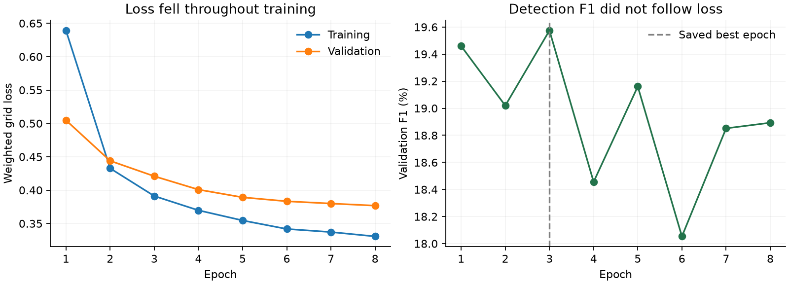
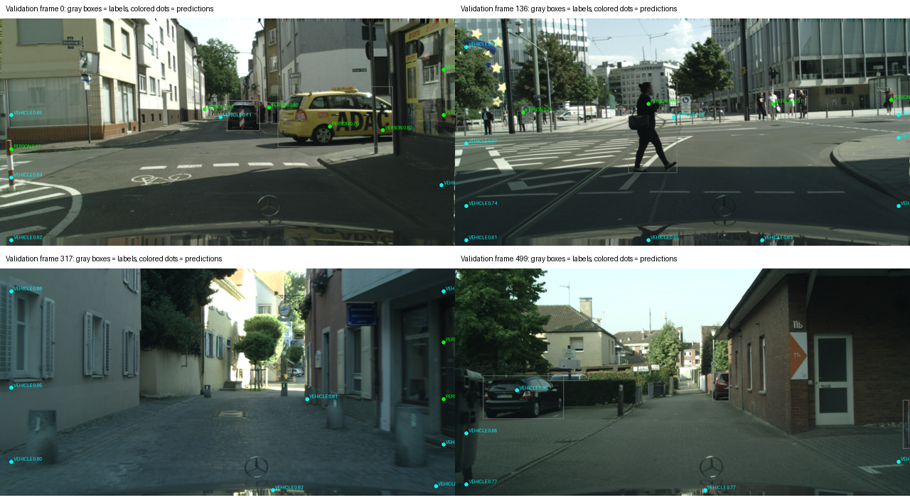

# My Cityscapes Person/Vehicle FOMO baseline, 2026-10-04

I completed conversion, inspection, sanity training, baseline training, validation, inference, and INT8 export on `tinyml-fomo`.
This is a local FOMO-inspired experiment with a published FOMO-style architecture, not an official Edge Impulse training result.
The pipeline runs, but the baseline misses most objects and is not ready for reliable CNN handoff or mobility decisions.

## Data and conversion

I retained 2,975 training images and 500 validation images from the official Cityscapes split.
The converter produced 62,121 individual boxes: 23,592 Person and 38,529 Vehicle.
Training contains 19,654 Person and 32,348 Vehicle boxes; validation contains 3,938 Person and 6,181 Vehicle boxes.
There are 18 images with no relevant individual objects, including 8 validation images.
All source images and prepared caches passed the full pixel/hash comparison, with no missing files, broken images, invalid boxes, cross-split group leakage, or duplicate image content across splits.
I visually inspected eight saved examples across the pilot and full conversion; the boxes and class mapping aligned with visible objects.
This was a complete structural audit plus sample visual review, not manual review of every box.
I used original instance IDs, never `labelTrainIds`, and skipped unresolved groups rather than guessing individual boxes.
Original images are referenced; resized RGB caches total 266,880,256 bytes including array headers.

## Training and sanity results

I used WSL Python 3.11.16, TensorFlow 2.21.0, Keras 3.15.1, and the RTX 3050 Ti GPU.
I reused the existing environment and installed no packages.
I initialized MobileNetV2 alpha 0.35 from the public Keras ImageNet weights, with an internal input rescaling layer.
The public input remains RGB 160 x 160 x 3 in [0,1].
The two-class model has 20,787 parameters and a 20 x 20 x 3 output including background.
I preserved Person 0 and Vehicle 1 as the public IDs and did not add Obstacle.
I used batch size 32, learning rate 0.001, object-cell weight 20, seed 42, and horizontal-flip augmentation.
The sanity run used 12 training images, 12 validation images, batch size 8, and 30 updates.
Its initial first-batch loss was 1.605414; the average training loss during those updates was 0.727375 and validation loss was 0.797712.
These loss values have different aggregation scopes; checkpoint reload, nonzero weight changes, and actual decoded detections were the sanity gates.
It found 29 validation objects, with 37 scored false detections and 177 missed objects.
This established that learning and inference execute, not that the model was accurate.
The full baseline completed 8 epochs and 744 optimizer updates; epoch 3 was best by validation F1 at confidence 0.60.
Fitting and the final checkpoint verification took 88.30 seconds, excluding conversion, source auditing, and initial setup/loading.
I halved the learning rate after two epochs without improvement and stopped after five epochs without a new best F1.
The final epoch was not used simply because it was last.
All 24 contract and conversion tests passed.

## Validation results

Both evaluations below use all 500 validation images, threshold 0.60, and an eight-input-pixel matching radius.
Precision excludes unmatched predictions in source void/group cells; those predictions are reported separately as ignored.
Recall includes all 10,119 labeled individual objects, including grid collisions.
The same validation split selected the checkpoint, so these are development-validation results, not an untouched final test.

| Model / class | Precision | Recall | F1 |
|---|---:|---:|---:|
| Keras / Person | 60.13% | 11.53% | 19.35% |
| Keras / Vehicle | 67.52% | 11.57% | 19.75% |
| Keras / Overall | 64.44% | 11.55% | 19.59% |
| INT8 / Person | 62.92% | 10.39% | 17.83% |
| INT8 / Vehicle | 65.40% | 11.16% | 19.07% |
| INT8 / Overall | 64.46% | 10.86% | 18.59% |

Keras produced 5,803 detections: 1,169 matched, 645 scored false positives, and 3,989 ignored predictions.
It missed 8,950 labeled objects.
INT8 produced 5,573 detections: 1,099 matched, 606 scored false positives, and 3,868 ignored predictions.
It missed 9,020 labeled objects.
GPU training-time and Windows CPU re-evaluation counts differ by a few detections near decision boundaries; the table uses the saved Windows evaluation reports.
Mean localization error among matched centers was 4.10 resized-input pixels for Keras and 4.04 for INT8.
That error excludes missed objects and must be read alongside the low recall.
The top-three CNN forwarding limit reduced Keras recall to 5.70% and INT8 recall to 5.49% on these crowded scenes.
The individual confidence scores are not calibrated probabilities of a safe warning.

## What the previews and diagnostics show

I saw useful detections in some scenes, many missed people/vehicles, and high-confidence predictions near ignored image borders.
Ignored regions do not provide reliable individual labels, so training did not teach suppression there.
The raw inference interface still returns those predictions; they can consume the three crop slots.
I did not hide those outputs or add an unvalidated border-filter heuristic.
Objects are often tiny after full-frame resizing: 13,738 training boxes and 2,668 validation boxes have at least one dimension below two input pixels.
Across the dataset, 22,257 extra object centers share cells, and 9,640 centers lie in mixed-class collision cells.
As a diagnostic, decoding the exact training-cell labels on validation still recovered only 28.14% of individual centers, because cell collisions, ignored conflicts, and connected-cell merging lose instance information.
This diagnostic is not a mathematical upper bound, but it demonstrates a representation/decoding problem beyond optimizer progress.
Lower loss did not produce steadily improving detection F1, which is why checkpoint selection used detection metrics.

## Export and timing

| Artifact / observation | Result |
|---|---:|
| Keras checkpoint, including training state | 511,345 bytes |
| Float32 TFLite model | 98,736 bytes |
| INT8 TFLite model | 70,736 bytes |
| Keras desktop single-frame model call, median / p95 | 5.46 / 6.15 ms |
| INT8 desktop single-frame model call, median / p95 | 0.72 / 1.21 ms |

I calibrated INT8 with 100 seeded training images, with no validation-image calibration.
Integer-only conversion and INT8 input/output invocation passed.
Quantization reduced F1 by 1.00 percentage points on validation.
The single-sample maximum probability difference was about 0.191, so I used the full validation comparison rather than treating successful conversion as quality preservation.
Timings use 30 warmed desktop calls with preprocessed input and exclude resizing, decoding, camera capture, and the CNN.
They are short desktop observations with host workload, not a controlled hardware comparison or ESP32 FPS.
ESP32 flash, peak RAM/tensor arena, latency, and FPS remain unmeasured.
The exported model size alone does not establish ESP32-CAM compatibility.

## Saved deliverables and next decision

- Best model: `artifacts/cityscapes-baseline-20261004/best.keras`, with metadata in `best.json` and every epoch in `history.json`.
- Prepared annotations: `artifacts/cityscapes-data-20261004/manifest.json` and its review receipt.
- Annotation previews: `artifacts/cityscapes-review-20261004/`.
- Keras validation: `artifacts/cityscapes-evaluation-20261004/`.
- Quantized model: `artifacts/cityscapes-export-20261004/model.int8.tflite`, with `report.json`.
- INT8 validation and prediction previews: `artifacts/cityscapes-int8-evaluation-20261004/`.
- Commands, label rules, and CNN coordinate/crop contract: `README.md`.

I verified actual inference returning two-class detection dictionaries and three padded RGB 96 x 96 crops.
The software handoff is available, but these detections are not reliable enough for system integration.
My next recommendation is a separate comparison of grid resolution/decoding and handling of unknown image borders, using a training-derived development split before touching the final evaluation protocol.
I did not run that follow-up, add Obstacle, download BDD100K, or change hardware.
All 56 previously tracked files and all three earlier model artifacts retained their original SHA-256 hashes.
I kept changes under `tinyml/fomo/`, left both branch tips unchanged, and did not commit, push, or merge.
