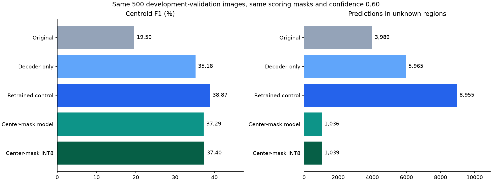

# My FOMO diagnosis and corrections, 2026-10-04

I diagnosed the existing Cityscapes Person/Vehicle checkpoint before changing model behavior.
I reproduced the original metrics from its saved predictions, then reran the preserved INT8 model and verified that its new probabilities exactly matched the saved ones.
I kept Fast-SCNN, original Cityscapes files, prior prepared data, and previous model artifacts unchanged.
My finalized system design is recorded in [STANDALONE_ARCHITECTURE.md](STANDALONE_ARCHITECTURE.md).

## Decoder losses

I evaluated 500 validation images containing 10,119 labeled objects.
I kept confidence 0.60, the eight-input-pixel matching radius, all object annotations, and the original evaluation ignore masks fixed.
This validation split has already been used for checkpoint and design decisions, so these are exploratory development results rather than independent test estimates.

| Preserved checkpoint and decoder | Precision | Recall | F1 | Matched objects | Scored false positives | Ignored predictions |
|---|---:|---:|---:|---:|---:|---:|
| Float, original connected merging | 64.44% | 11.55% | 19.59% | 1,169 | 645 | 3,989 |
| Float, cell NMS | 69.63% | 23.54% | 35.18% | 2,382 | 1,039 | 5,965 |
| Float, every positive cell | 54.22% | 49.94% | 51.99% | 5,053 | 4,266 | 11,330 |
| INT8, original connected merging | 64.46% | 10.86% | 18.59% | 1,099 | 606 | 3,868 |
| INT8, cell NMS | 69.44% | 22.88% | 34.42% | 2,315 | 1,019 | 5,906 |
| INT8, every positive cell | 53.85% | 48.84% | 51.22% | 4,942 | 4,236 | 11,379 |

The original decoder collapsed every eight-connected same-class activation chain into a single mean position.
That can join distinct objects through a few lower-confidence connecting cells.
I replaced the experimental default with confidence-ordered cell candidates and same-class suppression within one grid cell in each direction.
This preserves separated candidates within a connected chain while removing immediate duplicate candidates.
I retain `connected` and `cells` as explicit alternatives for reproducibility.
I selected cell NMS as the more conservative default because retaining every cell substantially increases the number of scored false positives and unknown-region outputs, despite its higher F1.
This is a precision/recall tradeoff, not proof that NMS is optimal for navigation.
Even NMS produces more absolute false positives than the original decoder, so improved precision does not mean fewer unwanted warnings without decision-level evaluation.

I do not count unmatched predictions in source unknown/group regions as proven false positives.
They remain visible in inference and are reported separately rather than hidden with ground-truth masks.
Precision therefore applies only to scored predictions and must be read alongside the ignored count.
All changes above are postprocessing changes with identical frozen model weights.

## Small objects and grid collisions

| Minimum box dimension after 160 x 160 resize | Labeled objects | Original float recall | Float recall with cell NMS |
|---|---:|---:|---:|
| Below 2 pixels | 2,668 | 6.33% | 11.24% |
| At least 2, below 8 pixels | 5,257 | 11.30% | 20.16% |
| At least 8 pixels | 2,194 | 18.51% | 46.58% |

I match predictions against all objects together before attributing recall to size bins.
Small objects remain substantially harder even after the decoder correction.
I also decoded ideal grids built directly from annotations to isolate information lost before learning.

| Ideal annotation grid | Decode rule | Recovered labeled objects |
|---|---|---:|
| 20 x 20 | Connected merging | 28.14% |
| 20 x 20 | One prediction per positive cell | 57.29% |
| 40 x 40 | One prediction per positive cell | 79.26% |

At 20 x 20, validation contains 3,734 extra centers sharing occupied cells and 1,821 centers in mixed-class cells.
At 40 x 40 those counts fall to 1,821 and 688 respectively.
These ideal-label results are diagnostics, not trained-model accuracy or mathematical ceilings.
I retained the 160 x 160 input and 20 x 20 output in the mask comparison to isolate that change.
I have not trained or benchmarked a 40 x 40 model in this diagnosis.
The [official FOMO documentation](https://docs.edgeimpulse.com/studio/projects/learning-blocks/blocks/object-detection/fomo) describes centroid overlap limitations and changing the MobileNet cut point to obtain a finer grid.
That change also alters feature depth and capacity, so I would compare actual models rather than infer accuracy from the ideal grid.
My model and decoder remain local FOMO-inspired implementations; I have not reproduced the official Edge Impulse training/SDK end to end.

## Overly broad training masks

The original converter marked a whole output cell ignored if any source pixel within it was unknown.
That includes cells whose prediction centers lie on clearly labeled background, particularly next to thin unannotated image borders.
On validation, the original mask ignored 71,953 cell observations; sampling the source label at each cell center ignores 21,853.
Across all 3,475 images, the center-based variant changes 345,049 raw mask entries and restores 329,721 background targets after known positive centers have been applied.
Genuinely unknown centers, unresolved groups, and mixed-class collisions remain ignored.
Known positive object centers continue to override source unknown regions.

I created a new manifest with `target_ignore_cells` for training and retained the original `ignore_cells` for evaluation.
I verified that every box, split assignment, source fingerprint, and evaluation ignore cell remained unchanged.
The new manifest references the existing resized RGB arrays rather than duplicating or rewriting images.
I inspected training example 0 and validation example 249 with side-by-side target overlays and completed structural inspection of all 3,475 records.
This restores supervision from existing labels; it does not invent negative labels for genuinely unknown source centers.

## Matched retraining comparison

I ran two new training experiments from the same ImageNet initialization and seed 42.
Both used the same 2,975 training images, 500 validation images, 20-epoch budget, batch size 32, initial learning rate 0.001, loss weighting, augmentation, decay/stopping rules, network, and NMS decoder.
The control used the original training ignore mask; the variant used center-based training masks.
Their adaptive learning-rate schedules and selected epochs differed in response to validation results.
The control selected epoch 20 and the center-mask run selected epoch 19.
Training and final checkpoint checks took 211.32 and 217.19 seconds respectively, excluding loading and source validation.
These are single-seed development comparisons, not evidence of statistical significance.

I evaluated both saved models on Windows against the original manifest so all scoring masks and boxes remained identical.
The figures below use those saved CPU evaluations; GPU checkpoint-selection counts differ slightly near numeric decision boundaries.

| Model with NMS | Precision | Recall | F1 | Matched | Scored false positives | Ignored |
|---|---:|---:|---:|---:|---:|---:|
| Retrained original-mask control | 72.88% | 26.50% | 38.87% | 2,682 | 998 | 8,955 |
| Retrained center-mask model | 70.33% | 25.37% | 37.29% | 2,567 | 1,083 | 1,036 |
| Center-mask INT8 model | 70.65% | 25.43% | 37.40% | 2,573 | 1,069 | 1,039 |

The center-mask model reduces unknown-region outputs by 88.43% relative to the matched float control, while losing 1.14 percentage points of recall and 1.59 points of F1.
It therefore addresses excessive unsupervised-region activation but is not a universal accuracy improvement over that control.
I preserve both checkpoints and treat the center-mask model as a separate candidate for further experiments.
My strongest demonstrated detection improvement comes from correcting connected-chain decoding, while small-object and same-cell losses remain unresolved.
Even the center-mask INT8 candidate misses 7,546 of 10,119 labeled objects.
It is not ready for reliable standalone navigation.

I calibrated the new export with 100 training images and verified full INT8 input/output execution.
Its file size is 70,736 bytes, with float32 TFLite at 98,736 bytes and Keras at 511,345 bytes.
INT8 F1 differs from this float model by +0.11 percentage points; class-level changes remain visible in the full reports.
INT8 Person precision/recall/F1 are 63.56% / 22.85% / 33.62%; Vehicle values are 75.16% / 27.07% / 39.80%.
Thirty warmed desktop INT8 model calls had median 0.61 ms and p95 0.81 ms, excluding capture, preprocessing, decoding, MicroSeg, and decision logic.
This is a short CPU observation, not an ESP32 benchmark.
I also ran the actual inference CLI, which returned six detections with a FOMO taxonomy and no crop output.

I inspected the new quantized preview for validation image 317.
The repeated border detections were gone in that example, but a false Person detection remained on the wall/tree region.
This is a sample visual check, not a substitute for the full validation counts.

## Architecture and pipeline corrections

I removed automatic creation of classifier crops from inference and removed the implicit three-detection output cap.
The preserved INT8 checkpoint with NMS recovers only 7.62% of labeled objects when restricted to its top three detections, versus 22.88% without that cap.
Warning selection is now explicitly a later decision-logic concern.
The legacy crop helper and its historical checkpoint metadata remain solely for inspecting old experiments and loading preserved artifacts.
No baseline inference path calls that helper.

FOMO and MicroSeg independently consume camera input, use separate taxonomies, and meet only in decision logic with optional ToF observations.
MicroSeg is the custom CNN; there is no third classifier in this baseline.
I documented alternating execution, output timestamps, the physical-board benchmark matrix, XIAO ESP32-S3 Sense with its camera setup, DevKitC N8R8, 8 MB PSRAM, VL53L1X reuse, and the agreed fallback options.
MicroSeg implementation and physical hardware measurements remain future work.

## Reproducibility and limits

All 31 regression tests pass, including connected-chain separation, same-class duplicate suppression, independent inference without crops, output beyond three detections, genuine unknown/group centers, and unchanged evaluation masks.
I reproduced the original full-validation metrics before changing decoding and ran fresh full-validation INT8 inference afterward.
I verified exact equality between the preserved and freshly invoked original INT8 probability arrays.
I preserve the original `cityscapes-baseline-20261004` and `cityscapes-export-20261004` directories.
Decoder comparisons are in `artifacts/diagnosis-float-nms-20261004/` and `artifacts/diagnosis-int8-nms-20261004/`.
Fresh invocation of the original INT8 model is recorded in `artifacts/verified-int8-nms-20261004/`.
The separate training-mask manifest and review receipt are in `artifacts/cityscapes-center-targets-20261004/`.
The matched control is `artifacts/diagnosis-control-training-20261004/best.keras`, evaluated in `artifacts/diagnosis-control-evaluation-20261004/`.
The center-mask candidate is `artifacts/diagnosis-center-training-20261004/best.keras`, evaluated in `artifacts/diagnosis-center-evaluation-20261004/`.
Its export is `artifacts/diagnosis-center-export-20261004/model.int8.tflite`, evaluated in `artifacts/diagnosis-center-int8-evaluation-20261004/`.
The aggregate comparison and chart are in `artifacts/diagnosis-summary-20261004/`.
The original INT8 model remains 70,736 bytes; decoding changes do not alter its weights.
I did not download BDD100K, add an untrained Obstacle output, or touch the phone pipeline.
No desktop measurement here establishes ESP32 memory use, latency, FPS, or suitability for mobility decisions.
I verified that all 56 tracked files and all seven model artifacts present at the start retained their SHA-256 hashes.
I stayed on `tinyml-fomo`, kept all new work under `tinyml/fomo/`, and did not commit, push, merge, reset, or rebase.
My next accuracy experiment would test a finer output grid using correctly regenerated center-based masks and a training-derived development split, followed by independent evaluation.
I would evaluate additional datasets such as BDD100K separately rather than assuming they repair spatial-resolution losses.
