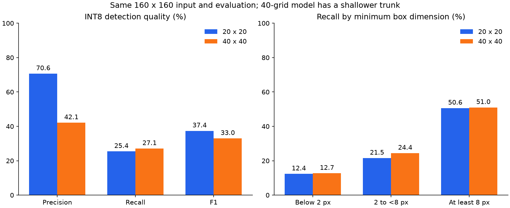

# My 20 x 20 versus 40 x 40 FOMO experiment

I ran this comparison on 2026-10-04 under `tinyml/fomo/` on `tinyml-fomo`.
I retained the independent FOMO module and the finalized FOMO plus MicroSeg architecture.
I did not add a secondary classifier, change detector classes, or modify Fast-SCNN.
I keep the 20 x 20 center-mask model as my reference: this 40 x 40 variant gains a little recall but loses precision and F1.

## What I held fixed

I retained 160 x 160 RGB input, direct-resize preprocessing, Person/Vehicle classes, MobileNetV2 width 0.35, a 32-channel head, and the same ImageNet initialization file.
Both experiments use 2,975 training images and 500 validation images from the official Cityscapes split.
I retained seed 42, batch size 32, an initial learning rate of 0.001, object-cell weight 20, flip augmentation, a 20-epoch budget, and the same adaptive stopping/learning-rate rules.
I retained the center-based training-ignore policy introduced in the diagnosis.
The comparison baseline is the saved `diagnosis-center-training-20261004/best.keras` model, selected at epoch 19.
I verified that current code reproduces its saved float and INT8 detection metrics exactly.
I reused that completed control instead of rerunning an identical experiment.

I fixed confidence at 0.60, centroid matching radius at eight input pixels, and same-class NMS radius at eight input pixels.
NMS therefore suppresses one neighboring grid cell at 20 x 20 and two at 40 x 40.
The original 20 x 20 evaluation ignore regions and every evaluation box remain identical for both models.
The output cap remains disabled, and neither model creates crops for another CNN.

## What changed

| Property | Existing baseline | Finer-grid experiment |
|---|---|---|
| Input | 160 x 160 x 3 | 160 x 160 x 3 |
| Output | 20 x 20 x 3 | 40 x 40 x 3 |
| Output stride | 8 input pixels | 4 input pixels |
| MobileNet cut point | `block_6_expand_relu` | `block_3_expand_relu` |
| Parameters | 20,787 | 6,339 |

The finer grid uses a shallower feature extractor with fewer parameters, so this is not a pure resolution-only experiment.
Keeping the object-weight coefficient fixed also does not guarantee the same foreground/background loss balance when the number of cells changes.
I record those limitations rather than attributing every change solely to resolution.

I regenerated the 40 x 40 center-based ignore mask directly from each original instance PNG.
The new manifest reuses the original RGB arrays and preserves all original boxes, split assignments, source fingerprints, and evaluation masks.
I inspected target overlays for training example 1487 and validation example 249, and structural validation passed for all 3,475 records.
Across the full dataset, extra object centers sharing cells fall from 22,257 at 20 x 20 to 10,830 at 40 x 40.
Centers in mixed-class cells fall from 9,640 to 3,509.
These annotation counts indicate improved spatial representation, not measured detector accuracy.

## Verification before training

All 37 regression tests passed, including a 40 x 40 forward pass, checkpoint save/reload, source-mask resampling, collision separation, and consistent input-space NMS.
The new model completed 30 sanity updates on 12 training images and produced actual detections after checkpoint reload.
Its sanity run is a plumbing check, not a useful accuracy estimate.
The full run starts independently from ImageNet weights rather than continuing the sanity checkpoint.

## Completed training and accuracy

The full GPU run completed 12 epochs and 1,116 optimizer updates, selecting epoch 7 by validation centroid F1.
It stopped after five epochs without a new best F1, under the same 20-epoch maximum and stopping rule as the baseline.
Fitting and checkpoint verification took 98.89 seconds, excluding loading and source validation.
I evaluated the saved checkpoint and its INT8 export on all 500 validation images, containing 10,119 labeled objects.
The table uses Windows CPU evaluations; GPU checkpoint-selection counts differ slightly at numerical decision boundaries.

| Model | Precision | Recall | F1 | Matched | Scored false positives | Ignored predictions |
|---|---:|---:|---:|---:|---:|---:|
| 20 x 20 float reference | 70.33% | 25.37% | 37.29% | 2,567 | 1,083 | 1,036 |
| 40 x 40 float experiment | 43.94% | 26.55% | 33.10% | 2,687 | 3,428 | 2,092 |
| 20 x 20 INT8 reference | 70.65% | 25.43% | 37.40% | 2,573 | 1,069 | 1,039 |
| 40 x 40 INT8 experiment | 42.14% | 27.10% | 32.98% | 2,742 | 3,765 | 2,300 |

INT8 recall increases by 1.67 percentage points, while precision falls by 28.51 points and F1 falls by 4.41 points.
The new INT8 model finds 169 more labeled objects but produces 2,696 additional scored false positives.
It still misses 7,377 labeled objects.
Precision excludes unmatched predictions in the fixed unknown/group regions, whose counts are shown separately.
Those unknown predictions are retained in runtime output rather than hidden with ground-truth masks.

| INT8 class | 20 x 20 precision / recall / F1 | 40 x 40 precision / recall / F1 |
|---|---:|---:|
| Person | 63.56% / 22.85% / 33.62% | 34.58% / 22.24% / 27.07% |
| Vehicle | 75.16% / 27.07% / 39.80% | 46.96% / 30.19% / 36.75% |

| Minimum box dimension at 160 x 160 input | 20 x 20 INT8 recall | 40 x 40 INT8 recall |
|---|---:|---:|
| Below 2 pixels | 12.37% | 12.71% |
| At least 2, below 8 pixels | 21.53% | 24.42% |
| At least 8 pixels | 50.64% | 51.00% |

I perform one-to-one matching against all objects before dividing recall into size bins.
Fewer annotation collisions did not translate into a useful overall accuracy gain with this shallower network and unchanged training settings.
That does not establish that every finer-grid architecture would fail.
It shows that this particular cut-point change is insufficient.

## Export, timing, and memory observations

Full INT8 conversion and inference passed for the 40 x 40 model.
Both exports used the exact same 100 training images for calibration, verified by their recorded image IDs.
Quantization changed the 40 x 40 model's F1 from 33.10% to 32.98%, a decrease of about 0.12 percentage points.
The actual CLI returned 14 detections on a validation image, with valid original-frame coordinates and no classifier-crop output.

I benchmarked both INT8 models in the same process with one TFLite CPU thread each, 20 warm-up calls each, and 200 measured calls each over the same 100 prepared validation inputs.
I alternated model order to reduce systematic order effects.
Model-call timing includes input quantization and output copying/dequantization; the combined timing also includes Python decoding.
Camera capture, image resizing, MicroSeg, and decision logic are excluded.

| Observation | 20 x 20 | 40 x 40 |
|---|---:|---:|
| Keras file including training state | 511,345 bytes | 230,280 bytes |
| Float32 TFLite file | 98,736 bytes | 37,012 bytes |
| INT8 TFLite file | 70,736 bytes | 30,856 bytes |
| Desktop model-call median / p95 | 1.85 / 2.44 ms | 1.66 / 2.48 ms |
| Desktop decoding median / p95 | 0.20 / 0.37 ms | 0.34 / 0.64 ms |
| Desktop model plus decoding median / p95 | 2.07 / 2.82 ms | 1.99 / 2.95 ms |
| INT8 input tensor | 76,800 bytes | 76,800 bytes |
| INT8 output tensor | 1,200 bytes | 4,800 bytes |
| Largest logical tensor listed by desktop interpreter | 307,200 bytes | 307,200 bytes |
| Physical ESP32 peak RAM / FPS | Unmeasured | Unmeasured |

The new INT8 file is 56.38% smaller, but its output buffer is four times larger.
Its median desktop model-plus-decoder time is only about 4% lower, and p95 is slightly higher.
I do not treat that short host measurement as a reliable embedded speedup.
The listed tensor sizes are not a tensor-arena estimate and cannot be summed into a correct peak-RAM claim.
The future firmware must also account for runtime scratch memory, camera buffers, MicroSeg, and decision logic.

## Decision and saved outputs

I preserve both variants and leave the default training grid at 20 x 20.
I do not replace the reference model with this 40 x 40 checkpoint because its additional false detections outweigh the small recall increase under the current comparison.
Both variants remain inadequate for reliable navigation.
If I continue the finer-grid investigation, I need a controlled experiment that preserves or increases feature capacity rather than assuming an earlier cut point is sufficient.
I would also re-examine foreground/background weighting on a training-derived development split before using another independent evaluation set.
I did not run those additional experiments or download a new dataset here.

- New targets and review: `artifacts/grid40-targets-20261004/` and `artifacts/grid40-targets-review-20261004/`.
- Sanity checkpoint: `artifacts/grid40-sanity-20261004/`.
- Full checkpoint and history: `artifacts/grid40-training-20261004/best.keras` and `history.json`.
- Float evaluation: `artifacts/grid40-float-evaluation-20261004/`.
- INT8 export: `artifacts/grid40-export-20261004/model.int8.tflite`.
- INT8 evaluation and previews: `artifacts/grid40-int8-evaluation-20261004/`.
- Paired desktop benchmark: `artifacts/grid-size-benchmark-20261004/report.json`.
- Size-stratified recall and chart: `artifacts/grid-size-summary-20261004/`.

## Interpretation limits

This is a single-seed development-validation comparison on data already consulted in earlier experiments.
It is not an independent test of glasses-viewpoint performance.
Unknown-region predictions remain separately reported and are not automatically counted as confirmed false positives.
Tensor buffer sizes and desktop timings cannot establish physical ESP32 peak RAM, tensor-arena requirements, camera-to-feedback latency, or FPS.
Those measurements still require the actual board, runtime, camera buffers, and firmware.
