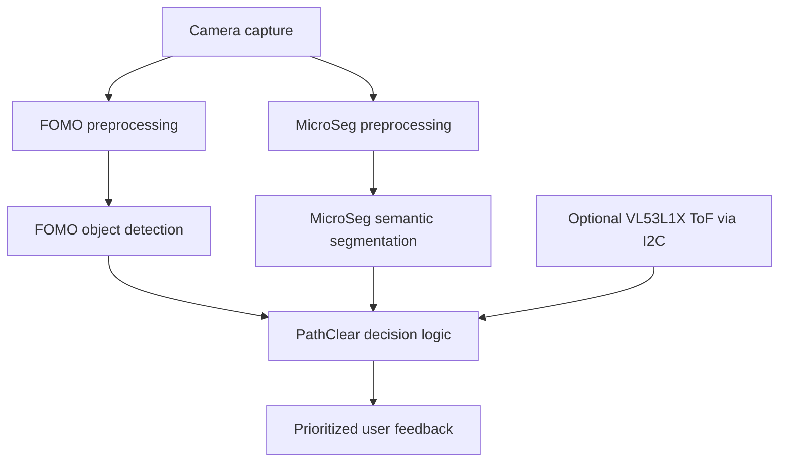

# My PathClear standalone architecture

I finalized this architecture on 2026-10-04.
I keep the phone's Fast-SCNN pipeline as the primary full semantic-segmentation system.
My standalone glasses are a reduced fallback and do not need to match the phone's ten-class capability.
This document supersedes earlier standalone proposals involving a cropped-object classifier.
I keep this decision document inside `tinyml/fomo/` to respect the current repository isolation rule.
The older shared documents outside this folder remain historical scaffolding and have not been edited.

## Independent camera modules

I use FOMO and MicroSeg as independent modules, both consuming camera frames.
Neither model receives the other model's output or object crops as its input.
The custom CNN is MicroSeg itself, a lightweight semantic-segmentation model.
I do not include a third custom CNN or a secondary classifier after FOMO in this baseline.
I would consider a secondary classifier only after experiments show that FOMO classifications are insufficient.

I combine outputs only in PathClear decision logic, optionally with ToF observations.
The phone Fast-SCNN pipeline remains separate and read-only during this experiment.
MicroSeg is an architectural decision here; its model, training pipeline, weights, and firmware integration are not implemented yet.

## Separate taxonomies and contracts

| Module | Intended classes | Output | Current state |
|---|---|---|---|
| Phone Fast-SCNN | Existing ten-class PathClear taxonomy | Full semantic segmentation | Existing pipeline, unchanged |
| FOMO | Person, Vehicle, Obstacle | Class, confidence, approximate image centroid | Current checkpoint supports Person and Vehicle only |
| MicroSeg | Walkable, Road, Boundary, Crosswalk | Spatial semantic mask with its own class IDs | Proposed taxonomy; annotation rules and model still to be implemented |

I do not reuse FOMO IDs as MicroSeg IDs or map either list implicitly to the phone taxonomy.
I keep background, unknown/void, model version, and class mappings explicit for each module.
I define Obstacle with reviewed object annotations before adding that output; current Cityscapes conversion does not train it.
I define Walkable, Road, Boundary, and Crosswalk with reviewed pixel-level labels before training MicroSeg.
Cityscapes does not supply a dedicated Crosswalk label, so I cannot claim that class is trained from the current conversion.
A Walkable prediction is a visual category, not a guarantee of safe passage.

My existing FOMO input is full-frame RGB resized directly to 160 x 160, with model-specific normalization.
Its public detection IDs are Person 0 and Vehicle 1.
Its internal background output channel is separate from those public IDs.
FOMO returns original-frame centroid coordinates and confidence without producing crops for another model.
The baseline software no longer truncates detections to three merely to fill classifier slots.
If firmware later needs a bounded detection buffer, I record the capacity and overflow count and evaluate the recall loss.
Warning prioritization belongs to decision logic and must not silently remove detections from model evaluation.

I specify MicroSeg input resolution, normalization, quantization, output-mask resolution, and ignore-label policy with its future model artifact.
I do not assume that they equal FOMO's settings.
Both module outputs need a frame identifier, capture timestamp, geometry transform, model/taxonomy version, and completion timestamp in the eventual firmware interface.
The current Python FOMO CLI is an offline image experiment, not that firmware scheduler.
Decision logic maps both outputs into a common camera coordinate system and checks output age before combining them.

## Scheduling and distance

Parallel means logically independent in this design.
It does not require simultaneous model execution.
On constrained hardware I can alternate FOMO and MicroSeg or run them at different frame rates.
I measure both the per-module update rate and the age of the information used for feedback.
If I share or reuse a camera buffer, I prevent capture from overwriting it while a module is reading it.
If I reuse an inference arena, I measure model-switching costs and preserve outputs before reuse.
I do not assume that sequential execution automatically removes both models' memory requirements.

I reuse the VL53L1X ToF sensor over I2C with board-appropriate wiring.
I keep range validity, timestamp, mounting direction, and field of view with its readings.
A single ToF reading is not an independent distance measurement for every FOMO detection.
Any association with an image region requires alignment and validation in decision logic.

## Hardware decisions

| Role | Board | Decision |
|---|---|---|
| Experimental baseline | Current AI Thinker ESP32-CAM | Measure feasibility without assuming that either or both models fit |
| Preferred upgrade | ESP32-S3 with 8 MB PSRAM | Evaluate quantized models and the complete camera pipeline |
| Preferred compact target | Seeed Studio XIAO ESP32-S3 Sense | Use the Sense camera setup |
| Development/testing | ESP32-S3 DevKitC N8R8 | Acceptable development board; select a compatible camera setup separately |

I do not plan to reuse the old ESP32-CAM camera module with XIAO.
I verify the supplied Sense camera revision when obtaining the board rather than assuming a particular sensor.
PSRAM capacity alone does not establish usable tensor-arena placement, operator support, or real-time performance.
The [Seeed board documentation](https://wiki.seeedstudio.com/xiao_esp32s3_getting_started/) is my reference for the Sense hardware setup.

## Required experiments

I run the following matrix first on the AI Thinker ESP32-CAM and then on the selected ESP32-S3 board.
If a model cannot allocate memory or execute on a board, I record that failure rather than inventing a performance estimate.

| Configuration | Accuracy measurements | Runtime measurements |
|---|---|---|
| FOMO alone | Per-class precision, recall, centroid F1, small-object recall | Peak RAM, tensor arena, model bytes, firmware size, model latency, total frame latency, FPS |
| MicroSeg alone | Per-class IoU, mean IoU, class recall, reviewed navigation-region errors | The same memory, size, latency, and FPS measurements |
| FOMO + MicroSeg | Both module metrics plus decision-level missed/false warnings on synchronized sequences | Combined peak RAM, both model sizes, scheduling overhead, per-module FPS, feedback latency and output age |

I report optional ToF integration as a separately identified condition with validity and alignment checks.
I measure internal RAM and PSRAM separately where the platform exposes them.
Peak memory includes camera buffers, preprocessing, live tensors, model runtimes, masks, detections, and decision logic.
Model file size is not the same as firmware size or inference RAM.
I record board and camera revisions, clock, image format/resolution, runtime/operator versions, quantization, warm-up, sample count, and scheduling policy.
I report median and p95 latency and sustained end-to-end FPS over a stated capture interval.
I do not convert desktop model-call latency into ESP32 FPS.
I keep unknown measurements explicitly unmeasured.
No physical-board or MicroSeg benchmark has been completed in this repository experiment yet.

## Fallback order

If FOMO plus MicroSeg is still too slow on ESP32-S3, I first reduce MicroSeg execution frequency.
I then consider simplifying MicroSeg's classes or model while measuring the resulting accuracy loss.
FOMO plus ToF alone remains a reduced fallback option.
If those options cannot meet the application's measured requirements, I move to stronger embedded hardware or an SBC.
I do not expand the standalone design merely to reproduce the phone's full ten-class capability.

## Current FOMO diagnosis

I preserve the original Cityscapes checkpoints and reports as historical baselines.
I document decoder changes, collision diagnostics, and their accuracy tradeoffs separately in `DIAGNOSIS_REPORT.md`.
I keep the two-class detector experiment distinct from the eventual three-class object taxonomy.
I do not implement MicroSeg, decision fusion, or hardware firmware as an implicit side effect of diagnosing FOMO.
